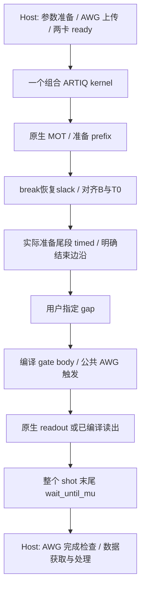

# realtime、封装实验函数与原生 ARTIQ 的接入边界

简单 Ramsey 可以继续使用 `NativeKernelPackage`，无需迁移原生类。
需要分别导入 MOT、冷却、态制备和读出类时，使用
[NativeModule / NativeProgram 多组件接口](native_components.md)。它保留独立实例，
明确 initialize/after_shot/finalize 生命周期；下文的 NativeKernelPackage 是继续支持
的单组件接口，finalize_method 保持旧的每 shot 含义。

`chunks="auto"` 是 AWG 内存分块策略，本身不要求换原生接入机制。
`compile_stream()` 是把电脑端编译产物逐点/逐块写入磁盘，全部编完后才执行；
它不是硬件边运行边编译。当前磁盘执行路径要求 `NativeProgram` 是实现限制，
不是使用现有 ARTIQ package 的物理要求。基础 Ramsey 使用普通 `compile()`。

## 从已有包登记一次

```python
package = NativeKernelPackage.from_package(
    root="path/containing/my_lab",
    entry="my_lab.stages:Stages",
    resources=("mot_ttl", "camera_ttl"),
    initialize_method="initialize_native",
    finalize_method="after_shot",  # 每 shot 调用，不是会话结束
)
prepare_MOT = package.kernel("prepare_MOT", timing="prefix")
readout = package.kernel("readout", timing="suffix", duration=100 * ms)
```

`root` 是包含顶层 `my_lab/` 的目录。工厂读取入口及包内静态 import 依赖，
固定源码 hash，不 import ARTIQ，也不执行用户包的 `__init__.py` 或实例化类。
外部用户源码可用 `source_overrides={"module.name": path}` 明确提供；不会从
当前 Python 环境自动复制第三方库。动态 import 不参与自动发现，应改用完整、
明确审阅的 `sources` 映射。

`.kernel(...)` 创建调用代理：上面的声明不执行 kernel，实验中调用
`prepare_MOT()` 时仅记录调用节点；导出的顶层 kernel 才调用原生方法。
把这些声明保存为实验室的 `native.py`，正文只需 `native.prepare_MOT()` 和
`native.readout()`。GreenMOTAdapter 已提供 `readout`，旧 `execute_readout` 名称保留。
准备中有 `break_realtime()` 时仍需保留可变前段/固定尾段划分；简化登记不改变
真实时间边界，不会自动删除 reset 或调用原类的 run/prepare/analyze。

现已实现 `NativeKernelPackage`：把已声明并固定源码版本的原生 `@kernel` 方法接入
`artiq_spectrum`，每个 shot 由一个顶层 kernel 在设备端调用原函数、编译 gate body、
原生读出与收尾。纯 ARTIQ 导出路径保持原行为。普通 DSL builder、原生调用代理和
真实仪器执行仍是三个不同阶段；构建和导出不会调用原生程序。

## GreenMOT 旧显式源码映射的兼容写法

新入门示例 [simple_ramsey.py](../examples/artiq_spectrum/simple_ramsey.py) 使用上面的
`from_package` 工厂。以下保留 [greenmot_ramsey.py](../examples/artiq_spectrum/greenmot_ramsey.py)
原先显式逐项登记源码的等价写法，用于理解已有程序，无需新用户重复维护文件映射：

```python
package = NativeKernelPackage(
    module="greenmot_stages",
    class_name="GreenMOTStages",
    sources={
        "greenmot_stages": adapter_path,
        "lib._GreenMOTbase": original_base_path,
    },
    resources=native_device_names,
    initialize_method="initialize_native",
    finalize_method="finalize_native",
)
prepare_prefix = package.kernel("prepare_MOT", timing="prefix")
finish_preparation = package.kernel(
    "finish_preparation",
    timing="timed",
    duration=15 * ms + 16 * ns,
    end_boundary="Zotino LDAC final rising edge; analog settling not included",
)
execute_readout = package.kernel(
    "execute_readout",
    timing="suffix",
    duration=100.48 * ms,
    phase_sensitive=False,
)


def prepare_MOT():
    prepare_prefix()
    finish_preparation()


with exp.average(100):
    with exp.sweep(dark_time):
        with exp.realtime():
            prepare_MOT()
            delay(10 * us)  # 从真实准备结束边沿到第一个 RF gate
            with exp.triggered_sequence(group="qubit_awg"):
                trigplay(q.rf, pulse)
                delay(dark_time)
                rz(q, math.pi / 2)
                trigplay(q.rf, pulse)
            execute_readout()
```

`package.kernel()` 返回 **DSL 调用代理**，只记录原生方法名、参数和来源位置。
`prepare_MOT()` 是把两个代理串接起来的简短 DSL helper；其内部动作仍由原生 kernel 执行。
运行时才由生成的顶层 kernel 调用外部类里原有的 `@kernel` 方法。不是 host 逐段
启动多个 kernel；也不是把原生函数翻译成若干 `play()`。`stage` 不需要参与。

当前限定一个 native package、一个外层 realtime、串行的 prefix→可选 timed 尾段→控制段→suffix；
原生调用必须是 realtime 的直接子节点，不能藏入 parallel/repeat/case/serial。
重复实验用外层 average/sweep；原生函数内部原有有限循环可以保留。
位置参数可使用标量、列表、单位量或 sweep，逐点绑定后生成 kernel 调用。

## 明确的执行边界

1. Host 校验目标和源码、初始化一次；必要时加载 AWG bank，每 shot 选择入口、arm 并等待两卡 ready。
2. 顶层 point kernel 在 shot 入口 reset；随后调用原生 prefix。prefix 可以恢复 slack，
   但不能再 reset。其时长不伪装成静态零时长，完整 shot 时长标为运行时未知。
3. prefix 结束后由组合器 `break_realtime()`，选择合法物理基准 B；逻辑控制相位原点
   **T0=B+origin_mu**。随后执行声明为 `timing="timed"` 的实际准备尾段，并断言其精确
   游标时长。GreenMOT 的 T0 位于这个尾段起点；恢复 slack 与 epoch 对齐全在它之前。
   timed 结束后的单参 `delay(...)` 显式定义准备结束到控制段的间隔，可按扫描点绑定。
4. `_taiyi_body_i(B)` 保留已验证的触发时间、预卷与内部 ARTIQ 操作；无中途 reset、
   break、host 往返或终止等待。AWG 接一次启动脉冲，自主执行所有 gate/delay/Rz。
   当前不把生成的输出倒排进 opaque native timed 调用中；提前触发与其重叠就报错，
   不加 padding、不移动门。本示例 lead=512 ns，准备后 gap 因而至少为 512 ns。
5. suffix 从 **逻辑控制段结束** 开始，不偷偷改成卡上 padding 结束。每个 suffix
   声明精确游标时长，返回时进行相等断言；超时或少时都报错，不补时。suffix 的用户
   调用图拒绝 reset、break、wait、硬件计数器读取、while、RPC 和动态调用；timed 同样适用。
6. 保留 Spectrum 的物理收尾占用；之后调用可选 finalizer，再进行整个 shot 的最终
   wait。finalizer 可以 break/wait，不能 reset。Host 最后检查卡完成并读取结果。

`native_control_t0_mu`、`native_physical_base_mu` 分别公开 T0 和 B。
每个 qubit 公开 `native_terminal_f_<uid>`，单位 rad，表示唯一持久驱动 frame F。
旧 `native_terminal_h_<uid>`、`native_terminal_v_<uid>` 为兼容来源字段，H=F+V；
新代码直接消费 F，不能再次扣除 V。相位敏感的 suffix 必须声明 `phase_sensitive=True`
并显式消费终态属性，相机强度读出可声明 False。
默认 AWG 载波以 sequence 入口为参考：prefix、timed 尾段及序列前 gap 不计入，
序列内部 Ramsey delay 计入。显式 phase_reference="shot" 则保留共同 T0，timed
尾段和 gap 也计入。首门自身相位和显式 frame 更新仍保留；定相不等于量子态复位。

## GreenMOT 的“准备结束”究竟在哪里

用户所需的是**真实准备结束 → 指定延迟 → 首个 gate**，不依赖函数是否叫 cooling。
此前额外的 cooling 只做等待，没有界定实际准备结束；它已从示例移除。
原 `prepare_GreenMOT()` 已包含压缩/冷却，本例在其最后三个语句之前切分：

```python
delay(15 * ms)
self.AOM_556_3DMOT.sw.off()
self.zotino0.set_dac([-0.95, 0.0], [2, 3])
```

这三个原语句成为 `finish_preparation()`。前面的原生准备可含 break，组合器再次恢复
slack、对齐 T0 后才执行这个真实尾段；尾段、指定间隔、Ramsey、读出之间不再 break/reset。
原文件不改；示例用 AST 将适配器前段和尾段拼回，与原函数逐语句核对，源码改变则拒绝。

官方 Zotino/AD53xx 的 `set_dac()` 先倒排 SPI 写入，再产生 LDAC 脉冲，返回游标仍为
调用时刻。最后 LDAC 上升沿晚两个 SPI ref period。适配器显式推进这 16 ns，声明
尾段时长 **15 ms + 16 ns**，结束边界为**最后 LDAC 数字上升沿**。它要求实际 core mu
为 1 ns、Zotino SPI ref period 为 8 mu；不满足时拒绝。倒排 SPI 位于 15 ms hold 内。

`scripts/verify_native_preparation_tail.py` 离线执行真实 ARTIQ 驱动函数，记录 SPI 和
LDAC 时间戳，确认返回游标及补齐 16 ns 后的结束位置；不运行硬件。数字更新完成不等于
DAC、电流或原子态已稳定，所需模拟稳定时间应明确纳入实验等待，默认 10 µs 未经物理标定。

```text
native prefix → break / epoch 对齐 → T0
                                      └─ 真实准备尾段 15 ms + 16 ns
                                          → 准备结束 → 指定 gap 10 µs → RF gate 1
                                                        └─ gate 前 512 ns 发公共 trigger
```

默认首门仍在 T0+15.010016 ms，载波参考改在该 sequence 入口，首相位为 0°；
正 Rz(π/2) 对第二门减 90°。dark=10 µs/1 ms/100 ms 时，第二门首相位为
18°/270°/270°。显式 phase_reference="shot" 才保留首门 108.1728° 的旧参考。
没有把 15 ms 原生尾段或准备前段存入 AWG 波形；它们的时间与 phase 作用由各自合同表达。
仅使用 prefix 而未声明 timed 尾段的旧用法继续支持，但它仍不承诺 prefix 最后边沿到首门固定。

编译期审计读取固定 hash 的源码和调用图，不导入它们；运行时复核源码、模块来源与
设备别名。原生资源与编译控制输出/共享总线必须分离，特别是 AWG trigger 独占。
当前不支持有隐式逐 shot DDS/RAM preload 的可嵌入 body。旧独立导出器的初始化、
驻留 RAM 等优化仍保留，不为接入原生程序而修改纯 ARTIQ 行为。

源审计和 timed/suffix 游标断言不是任意 Python 的证明系统，也不证明驱动内部每个边沿、
总线吞吐、模拟 settling 或实际幅相。真实编译、source audit、样本验证与实机验收
分别记录。原生相机触发不会自动生成旧 DSL acquisition handle；图像传输及数据
关联仍由明确配置的 host result adapter 完成。

## 当前 realtime 定义不变

普通 `with exp.realtime()` 构造可静态排程的单次 shot 时间线中的定时区域。里面可以调用函数；
只有函数产生的 DSL 节点被编译。普通 Python 仍在构建实验时执行，并不会因为
放入这个 context manager 就变成 ARTIQ kernel。realtime 的进入/退出不产生新 T0，
不重置 frame，也不自动同步或触发 AWG。新原生模式以明确的 prefix/timed/suffix 声明扩展
组合能力；timed、控制段和 suffix 具有相对 T0 的静态时间轴，prefix 保持运行时未知时长。

| 操作或函数 | 应放哪里 | 当前支持状态 |
| --- | --- | --- |
| 产生 play/delay/parallel/repeat/acquire 等节点的准备/冷却/读出函数 | realtime 内 | 支持，展开成同一个 shot 的定时操作 |
| trigplay/delay/Rz 组成的整段门 | realtime 内的 triggered_sequence | 支持，一次公共启动，板卡自主完成 |
| 参数读取、波形生成/上传、相机配置、图像下载/分析 | 构建/编译或 host shot 生命周期 | 支持相应接口；不占 DSL 定时序列中的虚构时间 |
| 已有 ARTIQ @kernel 函数 | 通过 NativeKernelPackage 声明的调用代理 | 支持同一顶层 kernel 组合；不直接调用原函数构建 DSL |
| 含 break_realtime 的原生前置程序 | 声明为 prefix，之后显式建立控制 epoch | 支持；prefix 时长不计入控制段相位 |
| 实际准备/冷却尾段到首门要求固定间隔 | 声明尾段为 timed，之后显式 delay | 支持精确时长断言；尾段禁止 break/reset，仅 shot 相位模式计入载波参考 |

内置 `taiyidsl.prepare(q, protocol=...)` 是历史上的有限 TTL protocol 操作，要求在
realtime 外；它并不等于用户的 `prepare_MOT()`。函数应放哪里由其实际行为决定，
不能根据函数名字是否包含 prepare 推断。

## realtime、kernel 与时间游标是三层不同概念

原生组合接口将已有 `@kernel` 方法记录为原生调用节点，绑定设备、参数和状态约定，
再与生成的 gate body 一起导出。它不要求把用户所有代码复制到一个巨大的函数里。

| 概念 | 所在阶段与作用 | 不代表什么 |
| --- | --- | --- |
| `exp.realtime()` | host 构建 DSL 时，收集有明确时间关系的节点 | 不启动 kernel，不立即执行仪器操作 |
| `@kernel` | 将 ARTIQ 函数编译到 core；同 core 的 kernel 可互相调用 | 函数入口不自动 reset；装饰器不保证整个函数耗时恒定 |
| `core.break_realtime()` | kernel 执行时，必要时把时间游标推到硬件时间之后的安全位置 | 不退出 kernel，不结束 DSL scope，不清空 RTIO FIFO |
| `core.reset()` | 清空 RTIO FIFO，重新设置时间游标 | 不等于逻辑 frame、DDS 或 DAC 的统一归零 |
| `exp.stage()` | 给一组 serial DSL 操作附加名字和参数记录 | 不创建 kernel，不增加 native 接入能力 |

当前 `realtime` 不能嵌套自身；`triggered_sequence` 应嵌在它里面；同一 core 的
`@kernel` 函数互相调用则是 ARTIQ 原生支持的方式。把 DSL builder 放进 kernel
也不是接入办法：DSL 应在 host 先构建和编译。反过来，在普通 Python 构建 DSL 时
直接调用原生 kernel，可能立刻向 core 发起执行，而不是留下待编译节点；不要这样调用。
[官方 kernel 调用语义](https://m-labs.hk/artiq/manual/core_language_reference.html#artiq.language.core.kernel)

在本地 ARTIQ 9 与所核对的官方实现中，`break_realtime()` 的游标行为可写为：

```text
cursor_after = max(cursor_before, sampled_rtio_counter + 125000 mu)
```

mu 为 1 ns 时，这个余量为 125 µs。即使游标仍领先硬件时间，只要领先不足这个余量，
它也可能向前移动；不是固定等待 125 µs。`reset()` 则先清空 FIFO，再把游标设到
采样硬件时间加该余量，不保留旧游标。两者都可以合法出现在原生 kernel 中，且不会
因为函数有 `@kernel` 就自动发生。[官方 Core 实现](https://m-labs.hk/artiq/manual/_modules/artiq/coredevice/core.html#Core.break_realtime)

因此，含 break 的 MOT 可以正常工作，局部事件仍按 RTIO 时间戳输出；问题是不能
不加处理就把其全部入口到出口声明成静态固定时长。严格控制窗口之前可以恢复 slack
并选择新的控制 epoch；窗口中若 break 实际移动了游标，就不能继续声称跨越该位置的
间隔固定。即使选择一个顶层 kernel，内部任意 break 也不会因此变成确定时长。
已证明为 no-op 的 break 不改变时间；当前仍拒绝 strict timed/suffix 中的 break，
不依赖“预计这次不会推进游标”的假设。

原生 Zotino 或 DRG 调用本身并不与 realtime 的目标矛盾；它们需要自己的时间、
资源和输出状态模型。当前 `play()` 只表达所支持的脉冲，不能表达整段 GreenMOT
的磁场更新、持续 DRG 和状态交接。“不能用几个 play 等价替换”不是禁止使用原生程序。

## 一个入口还是多个 kernel：取决于交接时序

可以保留多个短小的 `@kernel` 函数，由一个顶层 `@kernel` 依次调用。对于同一 core，
这些函数编入同一二进制，调用发生在设备端，不会逐段返回 PC。这样保留模块化，同时
减少 host 编译/加载/通信带来的调度余量压力。这是推荐的严格窗口实现方式，不是硬件
唯一允许的方式，也不是 `realtime` 的定义。

从 host 依次调用多个 kernel 也有两种明确不同的用法：

| 交接方式 | 能承诺什么 | 需要满足什么 |
| --- | --- | --- |
| 普通分阶段执行 | 阶段顺序；阶段间可接受可变等待 | 明确输出保持、初始化、队列处理，以及下一阶段的相位原点 |
| 保留 RTIO 游标的 seamless handover | 成功排程的跨 kernel 事件仍可保持精确时间关系 | 不清空队列，不临时重设游标，前段留下足够未来 slack，后段在截止时间前提交事件 |

ARTIQ 明确保留跨 kernel 的时间游标和 RTIO 时间，所以不能把“经过 host”直接说成
“输出必然抖动”。后段及时提交时，硬件仍按原时间戳执行；迟到会 underflow，而不是
自动保证成功。若通过 `break_realtime` 临时补救，跨段间隔便可能改变。单纯几行 host
函数调用顺序没有提供上述时间合同。[官方 seamless handover](https://m-labs.hk/artiq/manual/rtio.html#seamless-handover-and-synchronization)

如果不要求 MOT 到控制段的等待固定，可以采用独立 MOT kernel，再为控制段建立
新 epoch；仍需状态交接，不能在不检查当前 exporter reset 行为的情况下直接拼接。
若 cooling→首门或末门→readout 必须严格定时，优先把这些边界放在同一次设备端调用
中。粗准备和严格控制是否共用一个入口，是实现选择；严格窗口的时间承诺应保持明确。

## triggered_sequence 对 ARTIQ 的意义

对有 AWG 工作的块，ARTIQ 的启动动作确实是一次公共 TTL 脉冲（上升、下降两个边沿），
不是逐门触发。编译器还保留整块时长、资源、提前触发补偿、相位参考和下一操作的时间。
后续读出排在块的结束时间，而不是 TTL 脉冲下降沿之后立即执行。块内 delay/Rz 由
Spectrum 程序和预计算样本处理；它们不转成 ARTIQ 逐门等待或指令。

ARTIQ 可在 AWG 播放期间预先安排未来读出，不必靠 host 等 AWG 播完再启动 readout
kernel。已经启动的 AWG 内部时序不会被 ARTIQ `break_realtime` 重新排程；但这个
break 可能改变 ARTIQ 后续读出相对 AWG 的关系。编译期/host 上传与 ready 检查也不
属于该 TTL 指令本身。

## 已可运行的函数封装：DSL builders

新增 `exp.stage(name, parameters=..., exact_duration=...)`，它等同于带名称和参数
记录的 `serial`，没有额外等待、kernel 或硬件指令。多个操作封在一个 stage 中，
也就构成外部 parallel 的一个完整分支。`exact_duration` 是断言，不自动补零或延时。
stage 只在 realtime 中使用，也可以在 triggered_sequence 中为一组门命名。
stage 完全可选。triggered_sequence 已经提供边界和默认串行语义，其内部不需要
再套一层 stage；示例现已使用直接 trigplay/delay/rz 的写法。可复用 gate 子程序用
普通 DSL builder 函数封装即可；多步子程序作为 parallel 的一个分支时，仍需在函数
内部用 serial 分组，或使用具有同样串行分组作用的可选 stage。

```python
def cooling(exp, q, parameters):
    with exp.stage("cooling", parameters=parameters["cooling"]):
        optical_pump(exp, parameters["pump"])
        sideband_cool(exp, parameters, rounds=3)


# prepare_MOT/cooling/execute_readout 在这里都必须是 DSL builders。
with exp.average(100):
    with exp.sweep(dark_time):
        with exp.realtime():
            prepare_MOT(exp, q, parameters)
            cooling(exp, q, parameters)
            with exp.triggered_sequence(group="qubit_awg"):
                trigplay(q.rf, pulse)
                delay(dark_time)
                rz(q, theta)
                trigplay(q.rf, pulse)
            execute_readout(exp, q, parameters)
```

函数本身不再建立 realtime，也不调用仪器，不使用 `time.sleep` 代替 DSL delay。
每个函数在构建 IR 时运行一次；扫描/平均通过编译节点和执行计划展开，不是靠
重复调用这个 Python builder 来产生硬件动作。现有 `taiyidsl.cooling` 已有
optical_pump、sideband_cool、illuminated_readout 等真实 DSL 组合操作。

完整可运行示例为 [staged_workflow.py](../examples/artiq_spectrum/staged_workflow.py)：
显式传入三个 builder，组合多个 DDS 操作、有限循环、AWG Ramsey、照明与 acquisition
触发并行。默认函数明确叫 demo_*，只是 DDS/TTL 离线时序夹具，**没有实现真实 MOT、
Zotino 磁场或原子装载**。示例会拒绝误传的已标记 ARTIQ kernel、协程和生成器函数；
它不是 Python 沙箱，无法检查可信用户函数内部隐藏的所有副作用。

## 用户提供 GreenMOT 代码的实际审阅

来源：[production/_GreenMOTbase.py](https://github.com/TaiyiQ/atom-control/blob/production/artiq-master/lib/_GreenMOTbase.py)。
2026-11-10 通过已登录浏览器读取，553 行；文件最后修改 commit 为
[`150c7fe724e8af078d97eeb8718f3e10d210d69c`](https://github.com/TaiyiQ/atom-control/blob/150c7fe724e8af078d97eeb8718f3e10d210d69c/artiq-master/lib/_GreenMOTbase.py)。
没有执行或改动远端代码。

| 位置 | 已看到的行为 | 接入含义 |
| --- | --- | --- |
| init_hardware，58–90 行 | core.reset、驱动初始化、break_realtime | 作为整体初始化处理，不能在准备与门之间再调用 |
| prepare，93–95 行 | 普通 Python，把 scan 转为浮点参数列表，没有 @kernel | 留在 ARTIQ host prepare；不是 DSL prepare，也不是定时 MOT stage |
| start_556_fixed_sweep，99–134 行 | 直接写 CFR/DRG/profile；返回后 DRG 仍运行 | 函数返回不是资源释放；须记录驻留模式和持续输出 |
| compress_green_MOT_DDS，138–340 行 | 80 段，Zotino 与 DDS 截止时间更新，237 行 break_realtime，超时检查 | 局部 RTIO 时序明确，但整体入口到出口尚无固定时长合同 |
| start_B_field，394–398 行 | 500 次 Zotino 更新加固定等待 | 不能只按 delay 求总时长，驱动的 SPI/LDAC 时序也要计入 |
| prepare_GreenMOT，486–524 行 | 调用上述函数；498/514 行 break_realtime；末尾关闭 MOT 光、更新磁场 | 适合作为原生 prefix；交接时须核对输出保持状态与 settling |
| imaging_399_hor / imaging_556_ver 等 | 原生 TTL、RF 开关及固定等待；399 相机以下降沿触发 | 可保留原生 readout；必须声明 TTL 初始高电平、触发极性及资源 |
| initialization，532–550 行 | 关闭多个输出、wait_until_mu 后另有延时 | 应明确属于收尾还是下一 shot 初始化，不能按名字自动前插 |

源码没有测量反馈或 RPC，但**有限循环不等于已证明的固定入口到出口时长**。
`break_realtime()` 在游标领先硬件计数器不足安全余量时把它向前推进；不同 slack 下
可以不推进，也可以推进。它不会抹掉原生程序内部已排定 RTIO 事件的意义，但不能用于严格门窗口
内部的固定延迟补偿。[官方 Core 实现](https://m-labs.hk/artiq/manual/_modules/artiq/coredevice/core.html#Core.break_realtime)

另一个需要保留的细节：本地 ARTIQ 9 的 `CPLD.set_profile(channel, profile)` 接受
`set_profile(2, 7)`，不能将其误报为签名错误。Rev8 和 Rev9 的通道作用范围不同，
仍需核对实机协议及 DDS 通道索引。[官方 Urukul 实现](https://m-labs.hk/artiq/manual/_modules/artiq/coredevice/urukul.html#CPLD.set_profile)

当前 TaiyiDSL ARTIQ 设备能力是 DDS/TTL，未建模此文件所用 Zotino 和 DRG 操作。
把整个 GreenMOT 改写成几个 play 不能表达等价实验。推荐保留原生代码，新增有契约的
组合接口，而不是要求把已有 MOT 全部改成 DSL。

## 推荐的原生组合架构：同一 kernel，明确控制 epoch

下图是当前原生组合器的执行方式：



这仍然由 ARTIQ 执行整个 shot。native prefix 到新 epoch 的耗时可以不同，epoch 内的
门与读出边界严格确定。当前 GreenMOT 示例已将实际准备尾部纳入该窗口，固定其
结束边沿到首门的间隔；不能在它们之间使用任意 host 调用或临时 break_realtime。

ARTIQ 官方区分从 host 调用 kernel 和同一 core 的 kernel 调用 kernel。后者可以编入
同一二进制，正适合这种组合；普通 Python DSL 函数调用则没有这个含义。
[官方 kernel 语义](https://m-labs.hk/artiq/manual/core_language_reference.html#artiq.language.core.kernel)

不能把 `native_MOT()` 和当前生成的 `point_i()` 从 host 连续调用，就当作已经实现
了有验证的无缝交接。限制来自当前导出代码和状态约定，不是 ARTIQ 禁止多个 kernel：

1. 当前点内核入口 `core.reset()` 清空 RTIO FIFO；初始化也会关闭所用输出。
2. 当前点内核末尾有 `wait_until_mu`；若后面接原生 readout，它会耗尽调度 slack。
3. 当前源码变量 `t0` 是物理基准 **B**；逻辑相位原点是 **T0 = B + origin_mu**。
   AWG trigger = B + trigger_physical_mu = T0 + region_start − lead，必须保留预卷预算。
4. 前置程序可能留下 DRG、CPLD/profile、DDS RF 开关、DAC 保持电压和 TTL 电平。
   “函数已经返回”并不能证明排队事件已经执行或输出可被重新初始化。

因此已实现独立的 **可嵌入 body 导出器**：入口不 reset、不重复初始化；接收明确 B，
保留内部绝对时间与一次公共触发；末尾保留 cursor，不提前等待硬件追上；整体组合
完成后才最终 wait。原有 standalone exporter 的行为保留，以免破坏旧实验。
[官方跨 kernel 时序说明](https://m-labs.hk/artiq/manual/rtio.html#seamless-handover-and-synchronization)

控制 epoch 需要按现有时钟/trigger 校准契约选择，不等于简单取 `now_mu()`。
原生 prefix 在控制 T0 之前，其可变耗时不累积到本控制段的载波参考。
控制 T0 仍是排程和时序可视化原点；载波默认改以 sequence 入口为原点，
显式 shot 模式才将已编译的准备和冷却计入 `f(t−T0)`。
native 相位敏感 readout 必须显式接收末尾 frame；不自动清除或丢弃 virtual Z。

## native adapter 的实机接入与验收条件

当前只支持串行 native prefix/timed/body/readout，不支持把未审计 native 程序任意放进
parallel，也不假装能推导所有原生输出波形。原生区块必须保留源码版本及依赖身份，
在可视化中明确标为 opaque/native；没有展开模型就不能在图里画出猜测的脉冲。

执行顺序：

1. 固定 GreenMOT 源码与调用图；补齐真实 device_db、驱动版本/修改、core target、
   Urukul proto_rev、DDS/Zotino/TTL 接线、参数来源与 AWG 触发独占线路。
2. 区分一次性初始化、native prefix、严格冷却尾部、readout、最终收尾；记录每段
   输入/输出状态、资源/共享 SPI、持续 DRG 与模拟 settling。只报一个 duration 不够。
3. 已实现独立 native program contract 与组合 emitter，不把 Python callable 塞进 JSON，
   也不让普通 `exp.stage` 冒充原生程序接口。固定段才能声明可验证的 duration；prefix
   使用显式 epoch barrier，不静默改成固定时长。
4. 已拆出无中间 reset/wait 的可嵌入 body；一组上传/ready，一次共同触发，内部没有
   RPC、host 补数或逐门触发。初始化、状态交接与后置等待仅由顶层组合器负责。
5. 使用真实驱动进行离线编译和 RTIO 轨迹审计，覆盖 Zotino 提前 SPI 写窗口、LDAC、
   DDS profile/IO_UPDATE、跨段状态、prefix失败后不触发，以及末尾 frame 消费。
6. 最后进行真实硬件幅相、触发和保持状态验收；静态编译通过不替代物理测量。

Zotino `set_dac` 的底层实现会把 SPI 写排到当前游标之前，再恢复游标；load 又有自己的
时序。因此 native 资源占用不能仅按 delay 或函数返回位置估算，也不能把负向预写
窗口不加说明地挤进上一个 stage。[官方 AD53xx 实现](https://m-labs.hk/artiq/manual/_modules/artiq/coredevice/ad53xx.html#AD53xx.set_dac)

## 本轮已修正的 host 生命周期

活动 Spectrum 点现在按如下顺序执行：

```text
result_adapter.before_shot
→ Spectrum 验证/上传/arm/all-ready
→ ARTIQ _execute_point
→ Spectrum 完成检查
→ result_adapter.after_shot
→ 记录成功 receipt
```

before 失败不操作卡；上传/arm/kernel/completion 失败不调用 after，不记录成功 receipt；
after 失败同样不记录成功 receipt。无 AWG 工作的点保留原纯 ARTIQ 生命周期路径。
这些 hook 是数据/设备 host 协议，**没有因此成为原生 MOT 的无缝 kernel 组合器**。
before 之后的上传/arm 也没有固定耗时，不承诺 before 返回到首门的确定延迟。
