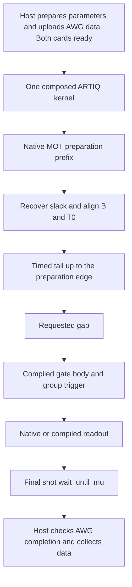

# Integrating native ARTIQ kernels with a realtime experiment

Use `NativeKernelPackage` to call an existing ARTIQ class from a hybrid Ramsey experiment. The experiment builder records the calls on the host. At execution, one top-level point kernel calls the original native methods and the compiled gate body on the core. Building or exporting the experiment never runs the native code.

When MOT, cooling, state preparation and readout come from separate classes, use [NativeModule and NativeProgram](native_components.md). Each component has its own instance and explicit `initialize`, `after_shot` and `finalize` lifecycle. In the single-component `NativeKernelPackage`, the existing `finalize_method` runs **after each shot**.

`chunks="auto"` controls AWG memory use and does not require a change of native interface. `compile_stream()` writes compiled points or chunks to disk, completing the build before execution starts. The disk-backed native execution path currently requires `NativeProgram`. Basic Ramsey examples use ordinary `compile()`.

## Register an existing package

```python
package = NativeKernelPackage.from_package(
    root="path/containing/my_lab",
    entry="my_lab.stages:Stages",
    resources=("mot_ttl", "camera_ttl"),
    initialize_method="initialize_native",
    finalize_method="after_shot",  # Called after each shot.
)
prepare_MOT = package.kernel("prepare_MOT", timing="prefix")
readout = package.kernel("readout", timing="suffix", duration=100 * ms)
```

`root` is the directory containing the top-level `my_lab/`. The factory reads the entry point and statically imported sources within the package, and pins their hashes. It does not import ARTIQ, run package initializers or instantiate the class. Use `source_overrides={"module.name": path}` to supply an external source explicitly. Dependencies are not copied from the host Python environment. For dynamic imports, supply a complete, reviewed `sources` map.

`package.kernel(...)` returns a callable DSL proxy. A call such as `prepare_MOT()` records the method, bound arguments and source location. The generated kernel invokes the method later. Put these declarations in a lab-owned `native.py` and call `native.prepare_MOT()` or `native.readout()` in an experiment. `GreenMOTAdapter` exposes `readout` and retains `execute_readout`. Registration does not rewrite resets or call the class's original `run`, `prepare` or `analyze`. Preparation containing `break_realtime()` still needs separate declarations for a variable prefix and a precise tail.

## Explicit source mapping for GreenMOT

The [simple Ramsey example](../examples/artiq_spectrum/simple_ramsey.py) uses `from_package`. The following equivalent explicit mapping shows how the original [GreenMOT Ramsey example](../examples/artiq_spectrum/greenmot_ramsey.py) divided the native calls.

```python
package = NativeKernelPackage(
    module="greenmot_stages",
    class_name="GreenMOTStages",
    sources={
        "greenmot_stages": adapter_path,
        "lib._GreenMOTbase": original_base_path,
    },
    resources=native_device_names,
    initialize_method="initialize_native",
    finalize_method="finalize_native",
)
prepare_prefix = package.kernel("prepare_MOT", timing="prefix")
finish_preparation = package.kernel(
    "finish_preparation",
    timing="timed",
    duration=15 * ms + 16 * ns,
    end_boundary="Zotino LDAC final rising edge; analog settling not included",
)
execute_readout = package.kernel(
    "execute_readout",
    timing="suffix",
    duration=100.48 * ms,
    phase_sensitive=False,
)


def prepare_MOT():
    prepare_prefix()
    finish_preparation()


with exp.average(100):
    with exp.sweep(dark_time):
        with exp.realtime():
            prepare_MOT()
            delay(10 * us)  # From the final preparation edge to the first RF gate.
            with exp.triggered_sequence(group="qubit_awg"):
                trigplay(q.rf, pulse)
                delay(dark_time)
                rz(q, math.pi / 2)
                trigplay(q.rf, pulse)
            execute_readout()
```

`prepare_MOT()` is a small DSL helper that records two proxies. The external `@kernel` methods retain their native device operations. There is no host relaunch between them. `exp.stage` is optional for ordinary DSL grouping and is unnecessary here.

The single-package mode accepts one outer realtime block and a serial sequence of native prefix, optional timed tail, control body and suffix. Native calls must be direct children of realtime. Nesting them in `parallel`, `repeat`, `case` or `serial` is rejected. Use an outer `average/sweep` for repeated shots and points. Native methods can retain their own finite loops. Positional arguments can be scalars, lists, physical quantities or sweep values and are bound per point.

## Execution and phase boundaries

1. The host checks target and source identities and initializes once. It loads AWG banks when required. For each active shot it selects the entry, arms the cards and waits for all cards to be ready.
2. The point kernel resets at shot entry and calls the native prefix. A prefix may recover slack but cannot reset the core again. Because its duration can vary, the total shot duration is marked unknown until runtime.
3. After the prefix the composer calls `break_realtime()` and selects a legal physical base B. The logical control origin is **T0 = B + origin_mu**. It runs the actual preparation tail declared `timing="timed"` and asserts its exact cursor duration. In GreenMOT, T0 marks the start of this tail. The one-argument `delay(...)` following the tail sets the requested gap between preparation completion and the control gates. A sweep can bind this gap per point.
4. `_taiyi_body_i(B)` preserves the trigger lead, pre-roll and internal ARTIQ events. It introduces no reset, break, host round trip or terminal wait. The AWG runs all gates, delays and virtual Z operations from one group launch. The composer rejects an early generated event that would overlap an opaque timed tail. It cannot back-schedule into that native call. With the example's 512 ns lead, the gap after preparation must be at least 512 ns.
5. The native suffix starts at the **logical end of the control body**, even if a card still has trailing padding. It declares an exact cursor duration, checked on return. Both an overrun and an underrun fail. The timed-tail and suffix call-graph audits reject reset, break, wait, hardware counter reads, `while`, RPC and dynamic calls.
6. After allowing for remaining physical Spectrum occupancy, the composer calls the optional per-shot finalizer and performs the shot's final wait. A finalizer may break or wait but cannot reset. The host checks card completion and collects results.

`native_control_t0_mu` and `native_physical_base_mu` expose T0 and B. Each qubit exposes its persistent drive-frame offset F in radians as `native_terminal_f_<uid>`. Legacy provenance fields `native_terminal_h_<uid>` and `native_terminal_v_<uid>` satisfy H = F + V. Consumers of F must not subtract V again. A phase-sensitive suffix declares `phase_sensitive=True` and explicitly consumes terminal phase attributes. Intensity readout can declare `False`.

The default AWG carrier reference starts at sequence entry. The native prefix, timed tail and gap before the sequence contribute no carrier advance in this mode. The Ramsey delay inside the sequence does. Select `phase_reference="shot"` to reference T0, including the timed tail and gap. Both modes preserve explicit frame changes and the pulse's own base phase. Establishing a carrier reference does not reset the quantum state.

## Define the actual end of preparation

The desired interval runs **from the last preparation edge to the first gate**. GreenMOT already performs compression and cooling in `prepare_GreenMOT()`. A helper that only waited could not identify that edge and was removed from the example. The adapter splits the original method immediately before its final three statements.

```python
delay(15 * ms)
self.AOM_556_3DMOT.sw.off()
self.zotino0.set_dac([-0.95, 0.0], [2, 3])
```

Those statements become `finish_preparation()`. Earlier preparation may break. The composer recovers slack and aligns the epoch before the timed tail, with no further break/reset through the gap, Ramsey gates and readout. The example reconstructs the original method from the adapter's two parts and checks its AST statement by statement. A change in the pinned source fails this check.

Zotino/AD53xx `set_dac()` schedules SPI writes backward from the current cursor, emits the LDAC pulse, and returns with the original cursor. The last LDAC rising edge is two SPI reference periods later. The adapter advances 16 ns explicitly and declares **15 ms + 16 ns** to the **last digital LDAC rising edge**. This contract requires a 1 ns core mu and an 8 mu Zotino SPI reference period. The SPI prewrites fall within the 15 ms hold. The adapter rejects other clock assumptions.

`scripts/verify_native_preparation_tail.py` runs the real ARTIQ driver functions offline and records the SPI and LDAC timestamps, return cursor and final edge after the added 16 ns. A digital update does not establish analog settling of DAC voltage, current or atomic state. Include any required settling in the explicit gap. The example's 10 µs gap has no physical calibration.

```text
native prefix → recover slack / align epoch → T0
                                      └─ timed preparation tail: 15 ms + 16 ns
                                          → preparation ends → requested 10 µs gap → RF gate 1
                                                        └─ common trigger 512 ns before the gate
```

The first gate starts at T0 + 15.010016 ms. With the default sequence reference its opening phase is 0°. A positive Rz(π/2) subtracts 90° from the second gate. For dark intervals of 10 µs, 1 ms and 100 ms its opening phases are 18°, 270° and 270°. Select `phase_reference="shot"` to obtain the earlier first-gate reference of 108.1728°. Neither the 15 ms native tail nor the earlier preparation is stored in AWG waveform memory. A prefix-only integration can omit the timed tail, but then its last edge has no fixed relationship to the first gate.

The compile-time audit reads pinned source and call graphs without importing them. At runtime the implementation rechecks source, module origin and device aliases. Native resources and shared buses must be disjoint from compiled control resources. The AWG trigger is exclusive. An embedded body cannot rely on an implicit per-shot DDS/RAM preload. The standalone exporter retains its own initialization and resident-RAM optimizations.

Source auditing and cursor-duration checks provide specific evidence. They cannot establish every edge inside a driver, bus throughput, analog settling or measured amplitude and phase. Record real compilation, source audit, sample verification and physical acceptance independently. A native camera TTL does not generate a DSL acquisition handle. Image transfer and data association need a configured host result adapter.

## Choose the right execution scope

| Operation | Where it belongs | Time contract |
| --- | --- | --- |
| A preparation, cooling or readout helper emitting `play/delay/parallel/repeat/acquire` | Inside realtime | Its DSL nodes enter the same timed shot |
| An AWG gate sequence with `play/trigplay`, `delay` and `rz` | `triggered_sequence` inside realtime | One group launch, then autonomous card playback |
| Parameter access, waveform generation/upload, camera configuration, image transfer and analysis | Builder, compiler or host shot lifecycle as appropriate | No fictitious duration on the shot timeline |
| An existing ARTIQ `@kernel` | Native package proxy | A device-side call inside the composed top-level kernel |
| Native preparation with a variable break | Prefix, before the explicit control epoch | Unknown duration outside the control phase reference |
| A preparation tail requiring a fixed gap to the first gate | `timed` tail and an explicit `delay` | Exact cursor-duration assertion, no break/reset. Only shot-reference mode counts the tail toward carrier phase. |

Ordinary `with exp.realtime()` collects DSL nodes with known timing relationships. Python still runs when building the experiment. Realtime entry and exit create no T0, frame reset, AWG synchronization or trigger. Native mode adds prefix/timed/suffix declarations. The timed tail, control body and suffix have static timing relative to T0, while the prefix retains its runtime-dependent duration.

The existing `taiyidsl.prepare(q, protocol=...)` is a finite TTL protocol written outside realtime. A user-defined `prepare_MOT()` can instead be a DSL helper or a native proxy. Its implementation determines where it belongs.

## Realtime scope, kernels and the RTIO cursor

| Construct | Effect |
| --- | --- |
| `exp.realtime()` | Collects timed DSL nodes on the host. Entering it issues no device calls. |
| `@kernel` | Compiles an ARTIQ function for the core. Same-core kernels can call one another. Entry neither resets the core nor guarantees constant elapsed time. |
| `core.break_realtime()` | Advances the cursor if required to restore scheduling slack. It leaves the kernel, DSL scope and pending RTIO FIFO contents intact. |
| `core.reset()` | Clears the RTIO FIFO and repositions the cursor. Logical frame state and DDS/DAC output state require their own controls. |
| `exp.stage()` | Attaches a name and parameters to a serial group of DSL nodes. |

Realtime scopes cannot nest. A `triggered_sequence` belongs inside one. Build the DSL on the host before compiling it. Calling a real kernel directly from host Python while building an experiment can start execution immediately. Use the native proxy to capture a call. See [ARTIQ kernel call semantics](https://m-labs.hk/artiq/manual/core_language_reference.html#artiq.language.core.kernel).

In the ARTIQ 9 implementation examined for this integration, the cursor after a break satisfies the following formula.

```text
cursor_after = max(cursor_before, sampled_rtio_counter + 125000 mu)
```

With 1 ns per mu the slack target is 125 µs. Even a cursor ahead of hardware may advance if the lead is too small. A break can also leave the cursor unchanged. `reset()` first clears the FIFO, then sets the cursor to sampled hardware time plus that margin, discarding the previous cursor. Neither call is implicit in `@kernel`. See the [ARTIQ Core implementation](https://m-labs.hk/artiq/manual/_modules/artiq/coredevice/core.html#Core.break_realtime).

A MOT function containing a break can still generate correctly timestamped local events. Its total duration across that break depends on incoming slack. Even inside one top-level kernel, a break that advances the cursor invalidates a claimed fixed interval crossing it. Strict tails and suffixes therefore reject breaks unconditionally. Native Zotino updates and DRG playback can be integrated under explicit resource, timing and state contracts. Ordinary DSL `play` has no equivalent for every magnetic-field update, running DRG or persistent driver state in GreenMOT.

## Handover between kernels

One top-level kernel can call several short same-core kernels. ARTIQ compiles them into a single binary, so the calls stay on the device. This preserves modularity and avoids host scheduling pressure at strict boundaries.

| Handover | Guarantee and requirements |
| --- | --- |
| Ordinary separate phases | Execution order with a variable inter-phase wait. Declare output holds, initialization, queue handling and the next phase origin. |
| Seamless handover across host-launched kernels | Scheduled events can retain their exact time relationship if both phases preserve the RTIO cursor and queue, the first leaves sufficient future slack and the second submits events before their deadlines. |

ARTIQ preserves RTIO time and cursor state across kernels. Timely submissions execute at their timestamps. Late submissions can underflow. A recovery break may change an inter-stage interval. Host call order alone does not establish a seamless handover. If the wait after MOT may vary, a separate MOT kernel and new control epoch are possible, provided the output state and exporter resets are accounted for. When cooling-to-first-gate or last-gate-to-readout time is fixed, keep those boundaries inside one device-side call. See [ARTIQ seamless handover](https://m-labs.hk/artiq/manual/rtio.html#seamless-handover-and-synchronization).

## What the AWG trigger schedules

For active AWG playback, ARTIQ issues one group launch with rising and falling TTL edges. The compiler tracks the entire block's duration and resources, early-trigger compensation, carrier reference and timing of subsequent operations. Readout starts after the logical block end. The card's static program and samples implement its internal delays and virtual Z operations.

ARTIQ can schedule a future readout while AWG playback is underway. A subsequent ARTIQ break leaves the launched AWG playback alone but can move the later readout relative to it. Compiling, uploading, arming and checking readiness are separate from the launch pulse.

## Group ordinary DSL builders

`exp.stage(name, parameters=..., exact_duration=...)` records a named serial group without adding a wait or hardware instruction. Its duration argument is an assertion. A stage may group several instructions into one parallel branch, or label gates inside a `triggered_sequence`. It belongs in realtime and is optional. A normal helper is sufficient to reuse an already serial sequence. Put `serial` or `stage` inside a multi-step helper if the whole helper should form one branch of a parallel group.

```python
def cooling(exp, q, parameters):
    with exp.stage("cooling", parameters=parameters["cooling"]):
        optical_pump(exp, parameters["pump"])
        sideband_cool(exp, parameters, rounds=3)


# prepare_MOT, cooling and execute_readout must all be DSL builders here.
with exp.average(100):
    with exp.sweep(dark_time):
        with exp.realtime():
            prepare_MOT(exp, q, parameters)
            cooling(exp, q, parameters)
            with exp.triggered_sequence(group="qubit_awg"):
                trigplay(q.rf, pulse)
                delay(dark_time)
                rz(q, theta)
                trigplay(q.rf, pulse)
            execute_readout(exp, q, parameters)
```

These helpers emit DSL once at build time. Neither `time.sleep` nor repeated host calls define the hardware schedule. Sweeps and averages expand through the compiled nodes and execution plan. `taiyidsl.experiments.cooling` includes `optical_pump`, `sideband_cool` and `illuminated_readout`.

The [staged workflow example](../examples/artiq_spectrum/staged_workflow.py) takes three builders and combines multiple DDS operations, a finite loop, AWG Ramsey and simultaneous illumination/acquisition triggering. Its `demo_*` functions are offline DDS/TTL fixtures. They do not implement MOT loading or a Zotino magnetic field. The example rejects marked ARTIQ kernel functions, coroutines and generators. A trusted Python builder is still responsible for any side effects it contains.

## GreenMOT source review

The original review on 2026-11-10 inspected the 553-line production file at commit `150c7fe724e8af078d97eeb8718f3e10d210d69c` without executing or editing it. See the [production file](https://github.com/TaiyiQ/atom-control/blob/production/artiq-master/lib/_GreenMOTbase.py) and [pinned revision](https://github.com/TaiyiQ/atom-control/blob/150c7fe724e8af078d97eeb8718f3e10d210d69c/artiq-master/lib/_GreenMOTbase.py).

The package pins the bytes of the **local files supplied to the exporter**. The adapter's AST check covers the order, arguments and values of the split preparation method and deliberately ignores formatting. To establish upstream identity as well, use a trusted checkout of `TaiyiQ/atom-control` containing the reviewed commit. From that checkout, compare the output of these two read-only commands:

```powershell
git rev-parse "150c7fe724e8af078d97eeb8718f3e10d210d69c:artiq-master/lib/_GreenMOTbase.py"
git hash-object --no-filters "C:/lab/artiq-master/lib/_GreenMOTbase.py"
```

Use the actual file passed to the adapter for the second command. Equal Git blob IDs establish byte identity, including line endings. Record the repository, commit, path and matching ID alongside the export's SHA-256. Repeat for other upstream files being claimed, including `artiq-master/repository/20261109/GreenMOT.py` if documenting the original entry point. The adapter wraps the base class and supplies a new lifecycle. A local hash or successful fixture compilation alone cannot authenticate files against upstream. If the bytes differ, identify and record the local revision or patch before attributing results to the reviewed version.

| Location in pinned file | Observed behavior | Integration contract |
| --- | --- | --- |
| `init_hardware`, lines 58–90 | Core reset, driver initialization, break | Initialize once before preparation and control |
| `prepare`, 93–95 | Ordinary Python converts the scan to a float list | Keep in ARTIQ host preparation |
| `start_556_fixed_sweep`, 99–134 | Writes CFR, DRG and profile registers. DRG remains active on return. | Track persistent mode and continued output |
| `compress_green_MOT_DDS`, 138–340 | 80 segments, timed Zotino/DDS updates, a break at line 237 and deadline checks | Local RTIO timing is specified. Total duration needs its own contract. |
| `start_B_field`, 394–398 | 500 Zotino updates with fixed waits | Include SPI/LDAC timing in addition to delays |
| `prepare_GreenMOT`, 486–524 | Calls the above functions, breaks at lines 498 and 514, disables MOT light and updates the field | Can serve as a prefix. Check final output holds and settling. |
| `imaging_399_hor`, `imaging_556_ver` and related methods | Native TTLs, RF switches and fixed waits. The 399 camera uses a falling edge. | Declare idle-high level, polarity and resources for native readout |
| `initialization`, 532–550 | Disables outputs and waits until a timestamp, followed by a delay | Decide explicitly whether this is teardown or next-shot initialization |

The review found no measurement feedback or RPC. Finite loops alone do not establish a fixed duration from entry to exit. The TaiyiDSL ARTIQ backend models DDS and TTL directly. Retaining the native code preserves Zotino and DRG behavior that a handful of DSL plays would omit. In the local ARTIQ 9 environment `CPLD.set_profile(channel, profile)` accepts `set_profile(2, 7)`. Rev8 and Rev9 have different channel scopes, so confirm the actual protocol and DDS channel index. See the [Urukul driver](https://m-labs.hk/artiq/manual/_modules/artiq/coredevice/urukul.html#CPLD.set_profile).

## The embedded body and control epoch



Prefix duration may vary before the epoch. Within it, the GreenMOT tail, first gate and readout have fixed timing boundaries. Calling a standalone `native_MOT()` and then a standalone `point_i()` on the host does not supply this contract:

1. The standalone point resets the core at entry. Initialization also disables outputs it uses.
2. Its terminal `wait_until_mu` consumes scheduling slack before a following native readout.
3. The generated `t0` variable represents physical base **B**. Logical **T0 = B + origin_mu**. The launch must satisfy **AWG trigger = B + trigger_physical_mu = T0 + region_start − lead**.
4. The preceding program may leave a running DRG, a selected CPLD/DDS profile, RF switch states, held DAC voltages, TTL levels or queued events.

The embedded body accepts B, retains the absolute schedule and group trigger, and returns its cursor without reset, repeated initialization or a final wait. The composer performs the final wait after native and compiled work has finished. The standalone exporter retains its original lifecycle. The composer selects the epoch using the target clock and trigger-calibration contract. Taking `now_mu()` alone is insufficient.

T0 remains the schedule and visualization origin. A variable prefix before it contributes no control carrier phase. The carrier uses the sequence origin by default. In shot-reference mode, compiled preparation and cooling contribute to `f(t−T0)`. A phase-sensitive native readout explicitly receives the terminal frame, including any persistent virtual Z.

## Hardware integration and acceptance

Native prefix, timed tail, body and readout form a serial composition. Opaque native calls carry pinned source and dependency identities. Show them as native blocks in a timeline. Individual analog pulses require a separate model or measurements.

1. Pin GreenMOT sources and call graph. Record the real `device_db`, driver revisions and local changes, core target, Urukul `proto_rev`, DDS/Zotino/TTL wiring, parameter sources and exclusive AWG trigger line.
2. Declare initialization, prefix, strict tail, readout and teardown. Describe input and output state, shared SPI, persistent DRG and analog settling for each.
3. Use a native package or program contract and its emitter. Only fixed regions may claim a verifiable duration. A prefix hands over at an explicit epoch.
4. Use an embedded body with no intermediate reset or wait. One upload/readiness sequence and common launch cover the active group. The strict window has no RPC, host refill or per-gate trigger.
5. Perform real-driver offline compilation and trace checks covering Zotino prewrites and LDAC, DDS profile/IO_UPDATE, cross-stage state, suppression of triggering after a prefix failure, and terminal-frame consumption.
6. Measure amplitude, phase, triggers and held outputs on the actual hardware.

`set_dac` performs SPI writes before the current cursor and restores the cursor afterward. LDAC has its own timing. Include the prewrite window in resource ownership when joining stages. See the [AD53xx driver](https://m-labs.hk/artiq/manual/_modules/artiq/coredevice/ad53xx.html#AD53xx.set_dac).

## Host result lifecycle

```text
result_adapter.before_shot
→ Spectrum validation, upload, arm and all-cards-ready check
→ ARTIQ _execute_point
→ Spectrum completion check
→ result_adapter.after_shot
→ record a successful receipt
```

A failure in `before_shot` leaves the cards untouched. If upload, arm, the kernel or completion fails, `after_shot` is skipped and no success receipt is recorded. A failure in `after_shot` also prevents a success receipt. Points without AWG work use the pure ARTIQ lifecycle. The host hooks coordinate devices and data. Upload and arm take variable time, so the return from `before_shot` has no fixed interval to the first gate.
